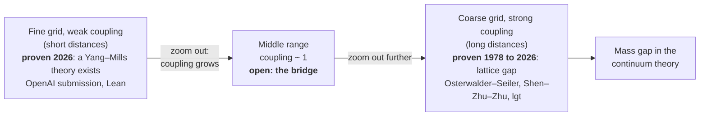
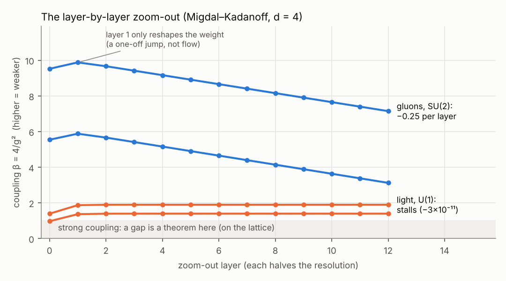
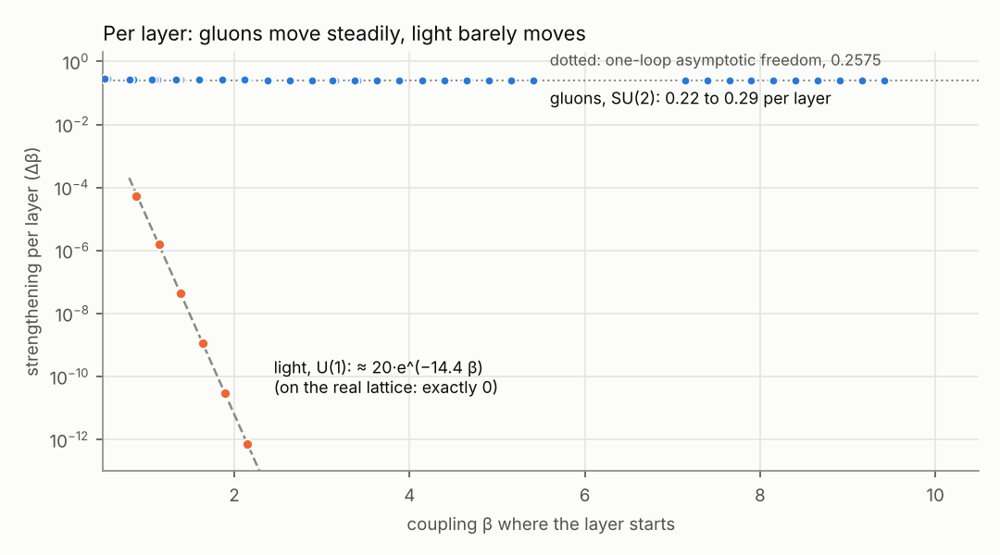
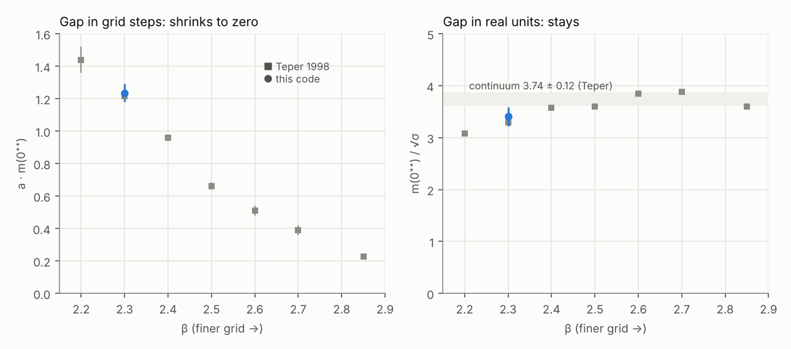
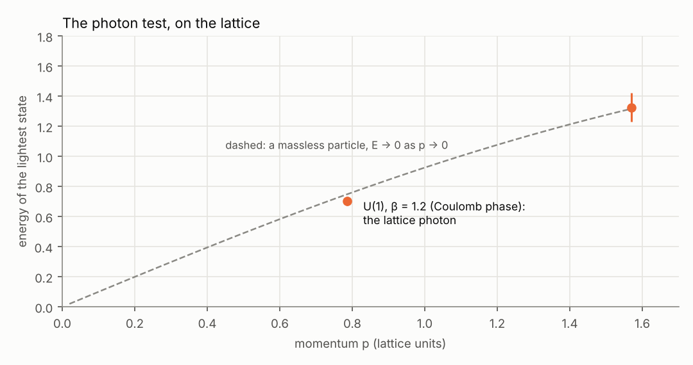

# The mass gap, read through DMP

*What a mass gap is, what DMP proves about its own, how far the real one is from proven, and an attempt at the missing piece.*

Status: handed over on 2026-11-21 to a local session (`HANDOVER.md`), written for the owner (a sysadmin, not a mathematician) and for the next session that continues it. Claim level,
as in the rest of this series: **we claim that every theorem named below is proved by Lean's kernel and that every number is reproduced
by the scripts here; we do not claim a proof of the Yang–Mills mass gap, and nothing here is one.** Nothing here has been reviewed by a
physicist or a mathematician.

- Lean: [`evidence/Dmp/MassGap.lean`](../../evidence/Dmp/MassGap.lean) (DMP's own gap), [`evidence/Dmp/Gauge.lean`](../../evidence/Dmp/Gauge.lean)
  (the dictionary to gauge theory). 36 theorems, all checked by `evidence/tools/check.sh` (279 in the chain, none resting on more than
  `propext`, `Quot.sound`, `Classical.choice`).
- Numerics: [`lattice/`](lattice/) (SU(2) and U(1) lattice gauge theory in four dimensions, validated against the literature) and
  [`hierarchy/`](hierarchy/) (the layer-by-layer zoom-out, Migdal–Kadanoff), with stored results in [`results/`](results/).
- **Continuing this work:** [`HANDOVER.md`](HANDOVER.md) (state, verified facts, ranked next threads, local setup, starting prompt).
- Prior work in this project: the research report on the 2026 existence proof (claude-internal, branch `ccr-9ed5a4e8-x9lo61`, closed
  draft #165, `reports/Yang Mills proof and GUID contribution.md`), and the Existence paper's answer to the owner's question "Is this
  (also) Yang-Mills?": "the forces are, and DMP as written is not" (`docs/existence/existence.tex`, §7.7). Before this folder the phrase
  "mass gap" occurred nowhere in the four root repositories.

---

## 0. The answer on one page

**What a mass gap is.** Picture a perfectly idle, perfectly balanced cluster: that is the *vacuum*. Anything that disturbs it and travels
on its own is an *excitation*. A theory has a **mass gap** when every excitation costs at least some fixed amount Δ > 0, a minimum ticket
price for existing at all. The equivalent picture, which is the one proofs use: every disturbance has a **finite blast radius**. Its effect
falls off exponentially with distance, the same fraction lost per hop, so far-away parts of the system are statistically independent.
Light has **no** gap: radio waves can be made arbitrarily long and cheap, and their effect falls off only slowly (by a power law). The
strong force is expected to have one: a single gluon never travels alone, and the cheapest thing that does (a *glueball*, a closed loop of
gluon field) weighs about 1.5 to 1.7 GeV for the real strong force, and 3.7 times the square root of the string tension for its two-colour
cousin SU(2).

**Why it is a millennium problem.** Physicists compute on a grid (a *lattice*), like a monitoring system that samples at a fixed rate. On
any grid a gap is free: there is always a smallest step. The question is whether the gap **survives making the grid infinitely fine**
while the real-world units stay fixed. Measured in grid steps, the gap must shrink to zero as the grid gets finer. Measured in real units,
it must stay put. Nobody has proved that it stays put. The lattice numbers say it does (section 6). On top of that, the equations of
Yang–Mills theory contain **no mass and no length at all**, so the gap has to appear out of nothing, from quantum effects alone. That is
like a protocol specification with no timeouts anywhere whose running system nevertheless develops a characteristic latency on its own.

**What is proven, by whom.**

| Piece | Status | By |
|---|---|---|
| A Yang–Mills theory exists in four dimensions (as a limit of lattices, along a chosen sequence) | proven, Lean-checked, validated 10 Nov 2026 | OpenAI's submission; the Gross committee's assessment |
| That theory has a mass gap | **open**: "The construction provides no evidence for or against a mass gap" | the committee, §2 |
| On a coarse grid at strong coupling, lattice Yang–Mills has a gap | proven since 1978, sharpened 2022, Lean-checked in the `lgt` library | Osterwalder–Seiler; Shen–Zhu–Zhu; `lgt` |
| The bridge: the fine-grid theory flows to the coarse-grid regime without losing control in between | **open: this is the problem** | Section 4 |
| DMP's own mass gap | **proven here** | `MassGap.lean`, section 2 |

**What we proved about DMP.** DMP's trust field (T32) has all three ingredients: a *mass* (one plus the members deriving through a
member), an *energy* (the potential: mass times shortfall, zero exactly in balance) and a *grid* (freshness counted in thousandths). In
DMP's own model: mass never goes below one. Any imbalance costs at least one quantum of potential, wherever it sits and however large
the boundary (`mg_gap_uniform`), and the gap is tight in every size (`mg_gap_tight`). Refine the clock and that potential gap **closes**
(`mg_refinement_closes_potential_gap`): DMP's energy is gapless in the continuum, like light. Only the counted mass keeps its gap. The
smallest cluster that stands alone has three nodes, derived from T3a's own premise (`mg_cluster_floor`). The stability margin μ is a gap
in time: with μ > 0 every staleness returns to balance in bounded time, and with μ = 0 it never does (`mg_returns_to_balance`,
`mg_marginal_never_returns`). So DMP has its mass gap **because it counts**. Physics has nothing to count; its gap has to be derived.

**What transfers.** A trust network in which every part keeps its own keys and every pair holds a key translation is, exactly, a lattice
gauge field: re-keying is a gauge transformation, closed loops of translations are Wilson loops, and DMP's "trust is a field, never a
position" is the fact that a gauge field lives on links, never on sites (`Gauge.lean`, proven for the integers and for the six
relabellings of a three-node cluster). The structure transfers. DMP's gap **mechanisms** (counting, floors, the stability margin) are
blind to whether translations commute, so on their own they would also give light a mass. Light is massless (proven for
four-dimensional lattice U(1) at weak coupling since 1980), so no such mechanism alone can be the proof (**the photon test**,
section 3). DMP's **classification** passes the test (owner's correction, 2026-11-21): the strong and weak forces are IM, the two-signed
medium, and light is payload. In gauge theory that is the carriers' self-charge C_A, and the zoom-out computed in section 5 runs at a rate
proportional to it (SU(3) against SU(2): 2.26 predicted 2.25; finding MG5).

**Our attempt at the missing piece.** We ran the bridge in its most DMP-like form: an exact layer-by-layer zoom-out over a tree of layers
(the Migdal–Kadanoff recursion, section 5). For gluons it works strikingly well. Per layer the coupling strengthens by a steady
**0.252**, against **0.2575** from the exact one-loop law of asymptotic freedom, and marches into the strong-coupling regime where the gap
is a theorem. For light, the per-layer change decays to **10⁻⁸ to 10⁻¹³**, where the truth is **exactly 0**. The tree approximation cannot
tell "exponentially slow" from "never". That is exactly the hole Ito and Seiler found in 2008 in Tomboulis's attempt to turn these layers
into a proof: the argument "would seem to work" for U(1), which deconfines. A proof has to control effects as small as 10⁻¹¹ per layer
and must use the one thing light lacks, non-commuting translations.

**Verdict.** DMP's own mass gap: **proven**. The physical mass gap: **not proven, by anyone**. DMP supplies a faithful vocabulary, a correct
dictionary and a sharp test, but no mechanism. The layer picture reproduces the physics numerically and fails the photon test exactly
where the experts said a proof must not. Section 8 lists what would move it.

---

## 1. The mass gap, in a sysadmin's terms

| Physics | Infrastructure picture |
|---|---|
| vacuum | an idle, balanced cluster: nothing pending, nothing stale |
| excitation, particle | a disturbance that can travel through the system on its own |
| mass gap Δ | the minimum ticket price: no disturbance that travels alone is cheaper than Δ |
| correlation length ξ = 1/Δ | the blast radius: beyond a few ξ, what happens here is independent of what happens there |
| exponential clustering | each hop loses the same fraction of the disturbance: the effect after n hops is at most qⁿ |
| no gap (light) | arbitrarily cheap, arbitrarily long waves; the effect falls off slowly, never "out of range" |
| lattice | a sampling grid; lattice spacing a = the sampling interval |
| continuum limit | sampling infinitely fast while reporting in real units (seconds, not ticks) |
| coupling g | how strongly neighbouring cells pull on each other |
| asymptotic freedom | at fine resolution neighbours are loosely coupled; zoomed out, the aggregate is tightly bound |
| renormalisation group | aggregating metrics layer by layer: per packet, per flow, per host, per site |
| gauge transformation | every part re-keys on its own; only what a closed chain of key translations does is meaningful |

Two consequences of the table are the whole difficulty.

**Grid units shrink, real units must not.** Let the grid be fine (spacing a). Measured in grid steps, the gap is a·Δ, and for the
continuum limit that number has to go to zero (the grid gets finer, the real gap stays). The proof has to show that a·Δ goes to zero at
*exactly* the rate a does. That is "uniform in the lattice spacing". It also has to hold however large the box ("uniform in the volume").
On any one finite grid a gap is guaranteed and meaningless, just as a counter that counts whole milliseconds never shows anything between
0 and 1 ms.

**The gap must come from nowhere.** The Yang–Mills equations have no parameter with the units of a mass. The quantum theory has to
generate a scale by itself ("dimensional transmutation"): the coupling grows as you zoom out, and where it becomes of order one, that
length *is* the scale. The proof has to follow the zoom-out through that middle range, where the coupling is neither small (so the tools
for weak coupling fail) nor large (so the tools for strong coupling fail).

---

## 2. DMP's own mass gap (proven)

All in [`evidence/Dmp/MassGap.lean`](../../evidence/Dmp/MassGap.lean), core Lean, checked with the rest of the chain. The model is T32 as
Gravity's constant writes it (`Field.lean`: `Held` is a standing's mass and freshness in thousandths, `phi` the potential).

| Theorem | In plain words |
|---|---|
| `mg_mass_at_least_one` | A member's mass is 1 + the members deriving through it, so never below one. Mass is a count. |
| `mg_member_term_le_phi` | One stale member alone puts at least mass × shortfall into the potential, whatever else the boundary holds. |
| `mg_gap_uniform` | **The gap.** Any member short of full freshness makes the potential at least one quantum. The bound does not mention the boundary's size: uniform in volume. |
| `mg_vacuum_iff` | The potential is zero exactly when every standing is fully fresh: the balanced state is the vacuum. |
| `mg_gap_tight` | For every size there is a boundary imbalanced by exactly one quantum: the gap is attained, and the same in every volume. |
| `mg_gap_at`, `phiAt_thousandths` | The same gap on a clock of any resolution R (thousandths are R = 1000). |
| `mg_refinement_closes_potential_gap` | **But a quantum is 1/R of a whole standing.** For every bound there is a clock and an imbalanced boundary lighter than it. In the continuum of its clock, DMP's energy has no gap. |
| `mg_mass_gap_survives_refinement` | The counted mass keeps its gap under every refinement: mass is not measured on the clock. |
| `mg_temperature_no_uniform_gap` | The one-number readout (temperature, an average) forgets a single stale quantum in a large boundary. |
| `mg_cluster_floor`, `mg_below_floor_falls` | A cluster that answers by majority, still answers after any single loss, and cannot be spoken for by one wrong node has **at least three nodes**, exactly. T3a's floor, derived. |
| `mg_recipe_respects_floor` | A well-formed recipe never holds a smaller singularity. |
| `mg_rounds_le`, `mg_returns_to_balance` | With verification faster than ageing (μ > 0) every staleness returns to zero in bounded time, faster with a larger margin, per member and so whatever the size. |
| `mg_marginal_never_returns` | With verification exactly as fast as ageing (μ = 0) a staleness never returns: the marginal, "massless" case. |

**What this says.** DMP has a mass gap because it **counts**: mass is a number of members, the floor is a number of nodes, and both are
whole numbers at least one. Its **energy** (the potential) has a gap only because freshness is counted in thousandths. Refine the clock and
that gap goes, which is exactly the trap the physics problem is about: a gap on a grid is free, and the question is whether it survives the
grid. In physics there is nothing to count. Gluon fields are continuous, and the gap has to be derived from how they interact.

---

## 3. The dictionary, and the photon test

### 3.1 A trust network with key translations is a lattice gauge field

Give every part its own key frame and every neighbouring pair a **translation** (how a key of one part reads in the frame of the other).
Let each part re-key whenever it likes (DMP: "the minting is a trust rotation: every key rotates"). Then no single translation means
anything on its own, because a re-keying changes it. What survives every re-keying is what a chain of translations does **around a closed
loop**. A loop that comes back to "nothing changed" is consistent; the amount by which it does not is its **shortfall**. Weight times
shortfall, summed over the small loops, is zero exactly when everything is consistent.

That is, word for word, Wilson's 1974 lattice gauge theory: parts are sites, translations are link variables, re-keying is a gauge
transformation, loops are Wilson loops, and the summed shortfall is the Wilson action. `Gauge.lean` proves the parts that are mathematics:

| Theorem | In plain words |
|---|---|
| `hol_rekey`, `loop_hol_rekey` | Re-keying changes a path only at its two ends, so a closed loop never notices it (telescoping). |
| `wilsonPot_rekey` | The summed loop shortfall is the same after any re-keying (gauge invariance). |
| `pure_gauge_balanced`, `wilsonPot_zero_iff` | A re-keyed trivial network is balanced; the potential is zero exactly when every checked loop is consistent. |
| `twisted_balanced`, `twisted_around`, `balanced_not_trivial` | **Balanced is not trivial.** On a 3 × 3 torus every small loop is consistent, yet the loop once around is off by one, and no re-keying removes that: a global twist invisible to every local check (finding MG3). |
| `abelian_loop_value_fixed` | Over the integers (the stand-in for light, U(1)), re-keying a loop's starting point leaves its value unchanged. |
| `perm3_group`, `perm3_not_abelian` | The six relabellings of a three-node cluster form a group, and their order matters. |
| `nonabelian_loop_value_moves`, `nonabelian_class_invariant` | Over those relabellings, re-keying the starting point **moves** a loop's value; only its class (the number of nodes it leaves in place, the trace) survives. |
| `perm2_abelian` | The two relabellings of a pair commute. |
| `contraction_decay` | **The skeleton of every gap proof:** if each layer passes on at most a fraction a/b < 1 of a disturbance, after n layers at most (a/b)ⁿ is left, with no system size in the bound. |
| `no_contraction_no_decay` | Without contraction a disturbance can travel undiminished: the massless case. |

DMP's VIBE potential has the same *shape* (weight times shortfall, zero in balance), but it measures freshness, not loop consistency: the
shape transfers, the content does not. And the relabellings of a three-node cluster (S₃) are also the relabellings of the three colours
of the strong force (the Weyl group of SU(3)), while the two-node ones commute. That this lines up with T3a's floor of three and the
owner's "Quark: three node cluster" (dmp#25) is a **reading**: a true coincidence of small numbers, not a derivation.

### 3.1a The mass gap in DMP's own terms (the owner's reading, 2026-11-21)

Read from the owner's notes in the Balance and Existence papers (`docs/balance/balance.tex` §"What it costs to exist", §"The VIBE
coefficient", the 29 October notes; `docs/existence/existence.tex` §"Particles", §"Leptons as the protocol between clusters", §"Forces as
IM") and his messages of 21 November:

| DMP / GUID | Physics | Consistent? |
|---|---|---|
| h, the universal quantum, quantises the **assertion** of existence; keeping an act in existence costs h·(1/c)·α per h, α the VIBE coefficient (Balance, 19:58Z note) | ħ is the quantum of action; every particle's mass times its Compton length is h/c | yes, as a reading (Balance tags the m·λ_C identity as physics) |
| inside a node (a glueball, a quark cluster) existence need not be asserted, it is guaranteed ("contained inside what must definitely exist, because it bounds a radius in which observation is guaranteed") | gluons are massless and never travel alone; the bound state has the mass | yes |
| IM: the strong force inside a node; between systems the weak force runs over GG, the verified inter-cluster protocol, with an existence handshake ("an external-IM packet / W-/Z-boson") | W and Z gain mass at the electroweak split; gluons stay massless | yes, qualitatively |
| light is payload: only information until it acts, then it becomes existence and ceases | the photon is massless and absorbed whole | yes |
| a node has mass because, as a whole, it must assert its existence over its own radius | **mass gap Δ = ħc / ξ**, ξ the correlation length (the radius beyond which nothing of a disturbance is left) | yes: this is the standard equivalence of a spectral gap and exponential clustering |

So in DMP's terms the Yang–Mills mass gap **is** the statement that IM always closes into nodes of bounded radius, the same bound at every
grid fineness. The reading passes the photon test (payload forms no node) and agrees with every qualitative fact in the table.

**Where it stops, precisely.** In DMP the node and its boundary are given: G0 is "stated, not derived", the cluster floor of three is an
axiom (T3a), the maximum depth is a setting (chapter 04). In Yang–Mills the bounded radius is exactly what has to be **derived** from the
dynamics; the Clay problem is the derivation. DMP therefore models a gapped world by axiom, consistently, and cannot supply the proof:
the thing to be proven is one of its axioms. The same pattern as MG2 (the stability margin μ is configured in DMP, derived in physics).
A number would follow from the reading only once "the radius" of a node is defined independently of its mass; until then m · λ = h/c holds
for every particle by definition and tests nothing (finding MG6).

**A first definition of the radius (2026-11-21, the owner asked for one; exploratory, not pre-registered).** DMP's own structures give
no physical length: depth counts grant links ("never network hops"), windows and the depth bound are configuration. The one length rule
in the owner's notes is "mass times the length it has to assert itself over" = h/c, used with a circumference for the electron
(α·h/c = m_e·2πr_e, Balance §"What it costs to exist"). Pure Yang–Mills has one scale, the string tension σ, the existence cost per unit
length of a stretched IM link. Taking a glueball as a closed IM loop of radius r:

| rule | equations (ħ = c = 1) | glueball mass | lattice, SU(2) |
|---|---|---|---|
| the loop's cost is the node's existence, asserted over its circumference | m = 2πσr and m · 2πr = 2π | m = √(2π) √σ = **2.51 √σ** | **3.74 ± 0.12 √σ** (Teper, Table 1) |
| the node settles where loop cost plus assertion cost is lowest | E(r) = 2πσr + 1/r, minimised | m = 2√(2π) √σ = **5.01 √σ** | |

Neither rule matches; the measured value lies between them (the geometric mean, 3.54, is not a rule and is not claimed). What the
reading does get right is the shape: a glueball's mass is a pure number of order a few times √σ, as in the closed-flux-tube models of
physics (Isgur and Paton, 1985). Caveats: these rules were derived with the lattice value already known, so this is an exploratory
check, not a pre-registered test; a fair test needs the rule fixed from DMP's text first and one number written down before comparing.

### 3.2 The photon test

Four-dimensional U(1) lattice gauge theory, the lattice theory of light, has two phases. At strong coupling it confines and has a gap. At
weak coupling it has a **massless photon**, proven rigorously (Guth 1980; Froehlich and Spencer 1982). So:

> **Any argument that would also give light a mass is wrong.**

This is a unit test with a known answer, and it is how the experts judged the most serious layer-by-layer attempt (section 5). It sorts
the DMP transfers at once. Every DMP mechanism that could yield a gap (counting, floors, the stability margin, member isolation)
means the same thing whether translations commute or not, so each of them alone would "prove" a photon mass. They can describe a gap;
none of them alone can be the reason for one. DMP's classification of the forces is different, and passes: IM, the two-signed medium (a
message passes a door only with both signatures, C19), is the strong and weak force, while light is payload that the gate never reads
and that acts only on the system it reaches. A gluon carries a colour and an anticolour and interacts with other gluons; a photon carries
no charge (finding MG5, the owner's correction of 2026-11-21). What light lacks and gluons have is exactly what `nonabelian_loop_value_moves` shows. A
gluon's field is not something every reader agrees on, only its class is. So a lone gluon is not an observable thing, while a lone photon
is. A proof has to use that.

---

## 4. The real problem: three pieces, one missing

**A. The short-distance end (proven, 2026).** OpenAI's Lean submission, validated by the committee chaired by Gross: for every compact
simple gauge group a Wilson-lattice scaling limit exists and satisfies the Wightman axioms, with the asymptotic-freedom law at short
distances. Its limits are stated by the committee: the infinite-volume limit is taken along a subsequence and not shown unique, and "The
construction provides no evidence for or against a mass gap" (assessment, §2, §8). The committee's own list of what remains includes "a
uniform mass gap".

**B. The long-distance end (proven on the lattice).** At strong coupling (a coarse grid with neighbours pulling hard on each other) the
lattice theory has a gap: Osterwalder and Seiler (Ann. Phys. 110, 1978) by cluster expansion; Shen, Zhu and Zhu (arXiv:2204.12737) by the
curvature of the group, for β below about 1/(16(d−1)); the `lgt` Lean library (mrdouglasny/lgt) formally for U(n) at β < 1/(32n(d−1)).
These proofs are all `contraction_decay` in spirit: show that each step passes on less than it receives.

**C. The bridge (open).** Stated as one lemma, the mass gap would follow if this held:

> **Bridge.** There is a physical length L₀ and a fraction q < 1 such that, along the scaling sequence of A, the theory zoomed out
> (block-averaged) to cells of size L₀ satisfies a contraction of the kind B uses, with the same q for every lattice spacing and every
> volume.

From the Bridge, `contraction_decay` (in its real-number form) gives correlations that fall like q^(r/L₀) at every lattice spacing and in
every volume. That needs the usual technical care, because a zoomed-out theory is not exactly nearest-neighbour, so the contraction has to
be of the robust kind (Dobrushin–Shlosman) that tolerates small long-range tails. A uniform bound survives the limit of A, and exponential
clustering of the reconstructed theory's correlations is a spectral gap of at least ln(1/q)/L₀. These steps are standard. **The Bridge
itself is as hard as the problem**: a gap implies something very close to it, so this reformulation localises the difficulty and does not
reduce it. The `lgt` library carries the same step as an "RG scale-transfer
bridge" whose key fields are "still stated as hypotheses".

---

## 5. Our attempt at the bridge: the layers, computed

**Why this route.** DMP's structure is a tree of layers ("restoration moves outward from the pair one layer per verification round",
T32). The simplest version of the zoom-out that can be computed exactly treats the lattice as such a tree: the **Migdal–Kadanoff recursion**
(1975/76). Each step merges 2 × 2 grid cells into one in two moves, "bond moving" (raise the plaquette weight to the power 2^(d−2)) and
"decimation" (combine four plaquettes into one). In 2007 Tomboulis (arXiv:0707.2179) tried to turn exactly these decimations, bracketed
between upper and lower bounds, into a proof of confinement at every coupling for SU(2). Ito and Seiler (arXiv:0711.4930, 0803.3019)
found three unproven steps and noted that the argument "would seem to work" for U(1) too, where confinement is known to be lost: the
photon test, failed. They concluded the alleged theorem "may hold for G = SU(N)" but that the problems "are, however, not easy to solve",
and "We are skeptical about the idea that the problem of quark confinement can be solved by soft analysis like this."

**What we computed** ([`hierarchy/mk_flow.py`](hierarchy/mk_flow.py), exact character arithmetic at 60 digits, no cancellations). We ran the
recursion for SU(2) (gluons) and U(1) (light) in four dimensions and read the coupling per layer in the heat-kernel coordinate, which the
recursion keeps (the first step only reshapes Wilson's weight into that form, a one-off jump of about +0.4 to +0.5 that is not flow).

Gluons, SU(2) in four dimensions. Per layer (one halving of the resolution) the coupling β = 4/g² falls by:

| start β (Wilson) | per layer, after the reshaping step | layers until β < 1 |
|---|---|---|
| 2.0 | 0.234 to 0.286 | 5 |
| 3.0 | 0.225 to 0.288 | 9 |
| 4.0 | 0.221 to 0.269 | 13 (β = 1.06 after 12) |
| 6.0 | 0.217 to 0.256 | ≈ 19 by the rate (12 computed) |
| 10.0 | 0.215 to 0.252 (0.2524 at the end) | ≈ 35 by the rate (12 computed) |

The exact one-loop law of asymptotic freedom gives 8·b₀·ln 2 = **0.2575** per layer (b₀ = 11·2/(48π²)); the tree's 0.252 at weak coupling
is 2% below it, and the rate rises towards strong coupling as the two-loop law says it should.

Light, U(1) in four dimensions. After the reshaping the per-layer change shrinks about 16-fold per layer, then stalls at a tail (positive:
towards strong coupling):

| start β (Wilson) | where it stalls (β_hk) | drift per layer |
|---|---|---|
| 1.0 | 0.884 | 5.4 × 10⁻⁵ |
| 1.25 | 1.139 | 1.6 × 10⁻⁶ |
| 1.5 | 1.392 | 4.4 × 10⁻⁸ |
| 1.75 | 1.643 | 1.1 × 10⁻⁹ |
| 2.0 | 1.894 | 2.9 × 10⁻¹¹ |
| 2.25 | 2.145 | 7.1 × 10⁻¹³ |

The tail falls like 20 · e^(−14.4 β) (local slopes 13.9 rising to 14.8). From β ≈ 1.9 the tree needs about 2 × 10⁹ layers to reach
β ≈ 0.9, a correlation length of 2 to the power of two billion grid steps.

Three dimensions, for contrast: both groups flow to strong coupling fast (β roughly halves per layer: SU(2) from 16 to below 0.1 in six
layers, U(1) from 8 to 0.23 in five). That is right for both: in three dimensions the coupling has units, and lattice light **does**
get a gap there (Polyakov's monopole mechanism, proven for every coupling by Goepfert and Mack, Commun. Math. Phys. 82 (1982) 545). The
photon test bites in four dimensions only, which is where the millennium problem lives.

Reproduce: `python3 hierarchy/mk_flow.py "SU(2)" 4 12 2,3,4,6,10`, `python3 hierarchy/mk_flow.py "U(1)" 4 22 1.0,1.25,1.5,1.75,2.0,2.25`
(and the same with `3` for three dimensions), then `python3 hierarchy/summarise.py`. Stored outputs: `results/mk_*.json`.

**The rate is the carriers' self-charge (added 2026-11-21, pre-registered in [`hierarchy/PREREG-SU3.md`](hierarchy/PREREG-SU3.md)).**
The same recursion for SU(3), the real strong force, computed on the eigenvalue torus ([`hierarchy/mk_torus.py`](hierarchy/mk_torus.py),
which reproduces the SU(2) table above digit for digit). One-loop physics says 1/g² changes per layer by an amount proportional to the
self-charge C_A (3 for SU(3), 2 for SU(2), 0 for U(1)); in β = 2N/g² that makes SU(3)'s drop 2.25 times SU(2)'s.

| start β, SU(2) / SU(3) (same 1/g²) | per layer, SU(2) | per layer, SU(3) | ratio (predicted 2.25) |
|---|---|---|---|
| 10 / 15 | 0.2520 | 0.5699 | 2.262 |
| 16 / 24 | 0.2512 | 0.5666 | 2.256 |

Both trees sit the same 2 to 2.4 % below the exact one-loop law (0.2575 and 0.5794). In DMP's words (finding MG5): the zoom-out is
driven by the second signature, and light, which has none, does not flow. Reproduce: `python3 hierarchy/mk_torus.py SU3 8 6,9,15,24`
(stored: `results/mk_su3_d4.json`).

**What it shows.**

1. **For gluons, the layer picture is right and fast.** The coupling strengthens by a steady 0.252 per layer, within 2% of the exact
   one-loop asymptotic-freedom value 8·b₀·ln 2 = 0.2575 (b₀ = 11·2/(48π²)), and reaches strong coupling, where B applies, after a number of
   layers proportional to β. That is the bridge working as hoped, but only in a tree approximation.
2. **For light, it stalls.** After the reshaping, the per-layer change shrinks about 16-fold per layer down to a tail that is itself
   exponentially small in β (from 5 × 10⁻⁵ at β ≈ 0.88 to 7 × 10⁻¹³ at β ≈ 2.1). In the tree, light still drifts towards confinement,
   just absurdly slowly (a correlation length of about 2 to the power of two billion grid steps). On the real lattice the drift is **exactly zero**
   (Guth; Froehlich and Spencer). The tree approximation therefore **fails the photon test**, by an amount far below anything a numerical
   check could resolve.
3. **So the bridge must control exponentially small effects.** Whether light has a gap is decided by effects of size 10⁻¹¹ per layer and smaller. A
   proof that keeps only "the coupling grows as we zoom out" at the level of the tree cannot distinguish the two groups. That is the
   precise sense of Ito and Seiler's "soft analysis", and the reason a DMP-shaped (layered, counting) argument cannot close it alone.
4. **What a proof must use.** The sign of the flow comes from non-commutativity: gluons carry the charge they transmit. In the
   language of `Gauge.lean`, the order of translations matters. A proof has to carry that through the middle range with errors below
   the U(1) drift. Nobody knows how. In three dimensions the coupling has units and the problem is easier; there is a 2026 outline of a
   proof for 3D by Nair (arXiv:2608.10133), unreviewed.

---

## 6. The numbers: the gap in grid units shrinks, in real units it stays

Evidence, not proof: our own lattice code ([`lattice/`](lattice/), numpy, CPU, fixed seeds), validated against the published SU(2)
numbers of Teper's review (hep-th/9812187, Table 10).

**SU(2): the gap in grid units shrinks, in real units it stays.** The published table (Teper, Table 10) shows the whole pattern: as the
grid is refined from β = 2.2 to 2.85 the gap in grid steps falls from 1.44 to 0.23, while the gap in units of the string tension
stays near 3.7. Our code reproduces the β = 2.3 point; the β = 2.4 and 2.5 runs were stopped part-way at the owner's request (2026-11-21)
to continue on the owner's laptop (`HANDOVER.md`).

| β | lattice | a√σ (string tension, grid units) | a·m₀₊₊ (gap, grid units) | m₀₊₊/√σ (gap, real units) | source |
|---|---|---|---|---|---|
| 2.3 | 10⁴, 3000 measurements | 0.363 ± 0.011 | 1.24 ± 0.05 | 3.41 ± 0.18 | this code |
| 2.3 | 10⁴ | 0.3687 ± 0.0022 | 1.216 ± 0.023 | 3.30 | Teper Table 10 |
| 2.4 | 14⁴ | 0.2686 ± 0.0021 | 0.959 ± 0.020 | 3.57 | Teper Table 10 |
| 2.5 | 16⁴ | 0.1834 ± 0.0026 | 0.660 ± 0.022 | 3.60 | Teper Table 10 |
| 2.6 | 20⁴ | 0.1326 ± 0.0030 | 0.51 ± 0.03 | 3.85 | Teper Table 10 |
| 2.7 | 32⁴ | 0.1005 ± 0.0020 | 0.39 ± 0.03 | 3.88 | Teper Table 10 |
| 2.85 | 48³ × 56 | 0.0636 ± 0.0012 | 0.229 ± 0.012 | 3.60 | Teper Table 10 |
| continuum | | | | **3.74 ± 0.12** | Teper Table 1 |

Plaquette at β = 2.3: 0.60224 ± 0.00006. String tension from torelons (flux closed around the box), gap from the scalar glueball, both
as effective masses from t = a to 2a with a variational basis of smeared operators, as in Teper's Appendix A.

**U(1): light is massless.** In the Coulomb phase (β = 1.2) the lightest state at the two smallest momenta of an 8³ × 16 box has energy
0.70 ± 0.03 and 1.33 ± 0.09, on the curve of a massless particle (0.75 and 1.32). This is a 200-measurement smoke test; the production
runs (two box sizes, both phases) are listed in `lattice/README.md` and `HANDOVER.md`.

**Production runs (2026-11-21, pre-registered in [`lattice/PREREG.md`](lattice/PREREG.md), evaluated by
[`lattice/photon_test.py`](lattice/photon_test.py)).** Energy E₁ of the lightest state at the smallest momentum 2π/L:

| phase | box | E₁ | massless value | E₁ · L |
|---|---|---|---|---|
| Coulomb, β = 1.2 | 8³ × 16 | 0.751 ± 0.011 | 0.748 | 6.01 |
| Coulomb, β = 1.2 | 12³ × 24 | 0.522 ± 0.005 | 0.512 | 6.26 |
| Coulomb, β = 1.2 | 16³ × 32 | 0.390 ± 0.004 | 0.388 | 6.24 |
| confined, β = 0.8 | 8³ × 16 | 0.86 ± 0.49 | 0.748 | |
| confined, β = 0.8 | 12³ × 24 | 1.85 ± 0.68 | 0.512 | |

In the Coulomb phase the energy falls like 2π/L (E₁ · L ≈ 2π = 6.28), and a fit E₁² = m² + E_free² gives m² = 0.0044 ± 0.0028,
consistent with a massless photon. **Verdict by the pre-registered rule: tension, not pass**, because the 12³ box lies 2.03 errors
above the massless value, just outside the 2-error limit; no fail (m is 1.6 errors from 0, the fail line was 3). In the confined phase
the energy does not fall with the box (ratio 2.1, the rule asked for more than 0.85): pass, with large errors. Stored:
`results/u1_*.npz`, `results/u1_summary.json`, `results/u1_photon_test.json`.

Stored: `results/su2_b2.3_L10.npz`, `results/u1_b1.2_L8_smoke.npz` (raw measurements), `results/lattice_summary.json` (the analysis).
Reproduce the analysis with `python3 lattice/analyse.py results/*.npz` and the figures with `python3 figures.py`.

---

## 7. The transfer ledger

In the scoring words of the GUID series: **theorem** (proved, here or in the literature), **reading** (a structural match that gives
no number of its own), **refuted** (fails a test), **open**.

| DMP structure | Gauge-theory counterpart | Verdict |
|---|---|---|
| Trust is a field, never a position (Axiom 2) | the gauge field lives on links, never on sites | theorem for the structure (`Gauge.lean`); reading as a statement about DMP |
| Key rotation at the minting | gauge transformation | theorem (`loop_hol_rekey`, `wilsonPot_rekey`) |
| A closed chain of verifications | Wilson loop, the only re-keying-proof observable | theorem for the integers and S₃; reading for DMP |
| VIBE potential = mass × shortfall, zero in balance | Wilson action = β × (1 − ½ Re tr U_p), zero for consistent loops | reading: same shape, different content (freshness, not loop consistency) |
| Mass ≥ 1, the floor of three (T32, T3a) | confinement: only composite, colour-neutral things travel; the lightest has a mass | DMP side theorem (`MassGap.lean`); as a mechanism for the physical gap on its own **refuted by the photon test** |
| IM (two signatures, C19) versus payload (unread by the gate) | carriers with self-charge (gluons: colour and anticolour, C_A = N) versus without (photon, C_A = 0) | the owner's reading (2026-11-21); passes the photon test; computed: the zoom-out rate is proportional to C_A (SU(3) : SU(2) = 2.26, predicted 2.25), finding MG5 |
| The potential's gap of one thousandth | a gap in lattice units | theorem that it closes under refinement (`mg_refinement_closes_potential_gap`): a grid artefact, exactly the trap of the physics problem |
| Stability margin μ > 0 | spectral gap of the dynamics (the rate of return to balance, the route of Shen–Zhu–Zhu) | DMP side theorem (`mg_returns_to_balance`); in DMP configured, in physics it has to be derived: reading |
| Member isolation (T32) | exact clustering | reading |
| Restoration one layer per round | the renormalisation group, layer by layer | reading; computed in its exact tree form: reproduces asymptotic freedom within 2%, **fails the photon test** (section 5) |
| Two independent witnesses (Axiom 1) | reflection positivity (a theory and its mirror image make a positive pairing) | reading, untested |
| Relabellings of three nodes do not commute; of two, they do | S₃ is the Weyl group of SU(3); non-commutativity is what light lacks | theorem for the groups (`perm3_not_abelian`, `perm2_abelian`); reading for the link to T3a |
| "Is this (also) Yang–Mills?" (dmp#25, 2026-10-28) | | the forces are; DMP is not (Existence paper §7.7), and the dictionary above is the precise sense in which DMP's vocabulary fits them |

---

## 8. What would move it, and how to continue

In order of what this project can actually do:

1. **Close the U(1) tail precisely** (`hierarchy/`): fit the drift per layer against β and compare it with the monopole-type estimate
   e^(−cβ). Then test Tomboulis's r-modified recursion against the photon test, exactly at the step Ito and Seiler flagged. That turns
   their prose objection into a number.
2. **Bounds instead of approximations.** Tomboulis's idea was to bracket the true lattice between two tree recursions. A checkable partial
   result: for a *finite* number of layers, rigorous interval-arithmetic bounds that the true SU(2) lattice at a given β lands in the
   strong-coupling region of B, with the same computation provably failing for U(1). It would hold only for that β, but it would be a
   theorem, and it is the "computer-assisted bound" the research report lists as a publishable kind of partial result.
3. **More lattice points**, β = 2.6 and 2.7 (section 6), on the owner's laptop or with the GUID v7 GPU code once it is in a repository.
   These show the same plateau with smaller errors.
4. **Audit work on the existence proof** (the research report's options 1 to 3): an external-kernel replay and statement-fidelity audits.
   They need no physics claim and give this project the Mathlib-scale build any formal bridge work would need.
5. **Findings for DMP** (`docs/findings.md`, MG1 to MG4), for the owner to decide.

What not to claim from this folder: that DMP explains or predicts the mass gap; that the layer computation is evidence for the bridge on
the real lattice; that our lattice numbers say anything about the continuum theory beyond what decades of published lattice work already
say; that `contraction_decay` proves anything about Yang–Mills.

---

## Sources

- A. Jaffe and E. Witten, *Quantum Yang–Mills theory*, the Clay problem statement: https://www.claymath.org/wp-content/uploads/2022/06/yangmills.pdf
- Yang–Mills group (Gross, Douglas, Jaffe, Klebanov, Nekrasov), assessment of the OpenAI submission, 10 Nov 2026: https://github.com/yang-mills-group/YM/blob/main/docs/assessment-1.pdf
- K. Osterwalder and E. Seiler, *Gauge field theories on a lattice*, Ann. Phys. 110 (1978) 440.
- H. Shen, R. Zhu and X. Zhu, *A stochastic analysis approach to lattice Yang–Mills at strong coupling*, arXiv:2204.12737.
- M. R. Douglas et al., `lgt`, Lean library for lattice gauge theory: https://github.com/mrdouglasny/lgt
- A. Guth, *Existence proof of a nonconfining phase in four-dimensional U(1) lattice gauge theory*, Phys. Rev. D 21 (1980) 2291.
- J. Froehlich and T. Spencer, *Massless phases and symmetry restoration in abelian gauge theories and spin systems*, Commun. Math. Phys. 83 (1982) 411.
- E. T. Tomboulis, *Confinement for all values of the coupling in four-dimensional SU(2) gauge theory*, arXiv:0707.2179; reply arXiv:0712.2620.
- K. R. Ito and E. Seiler, arXiv:0711.4930 and *Further discussion of Tomboulis' approach to the confinement problem*, arXiv:0803.3019.
- K. M. Bitar, S. Gottlieb and C. K. Zachos, Fermilab Pub-82/56-T (1982), on the Migdal–Kadanoff recursion's "known embarrassment" with
  the two phases of U(1): https://lss.fnal.gov/archive/1982/pub/Pub-82-056-T.pdf
- M. Teper, *Glueball masses and other physical properties of SU(N) gauge theories in D=3+1: a review of lattice results for theorists*, hep-th/9812187.
- V. P. Nair, *Towards a proof of mass gap in 3d Yang–Mills theory*, arXiv:2608.10133.
- K. G. Wilson, *Confinement of quarks*, Phys. Rev. D 10 (1974) 2445.
- M. Goepfert and G. Mack, *Proof of confinement of static quarks in 3-dimensional U(1) lattice gauge theory for all values of the coupling constant*, Commun. Math. Phys. 82 (1982) 545.
